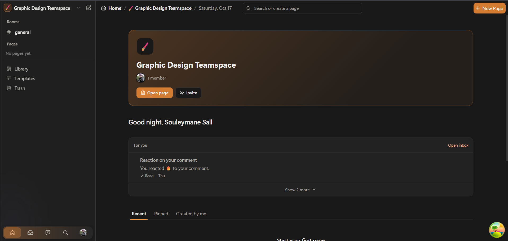
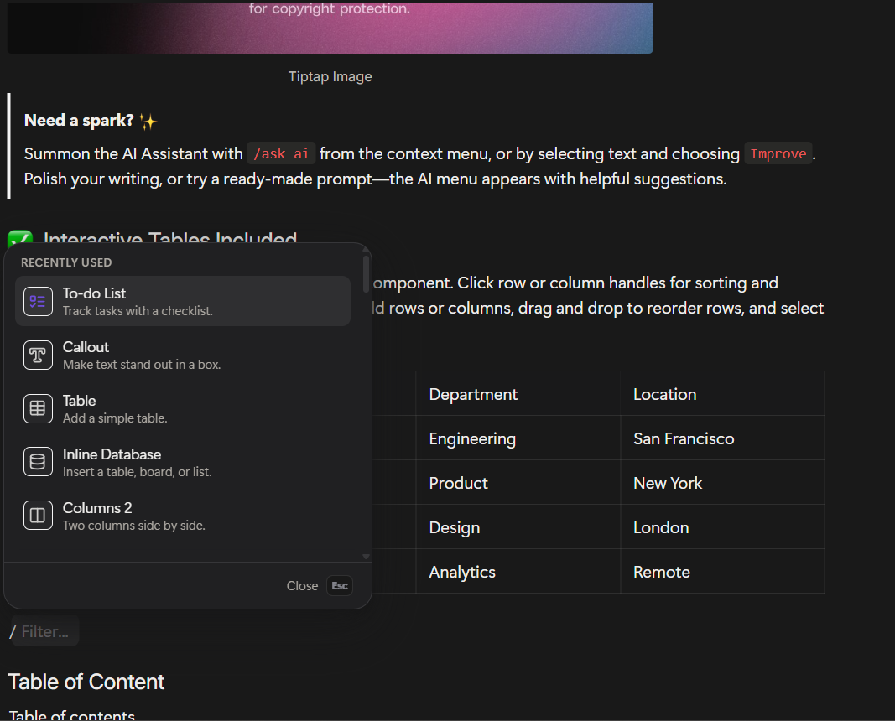
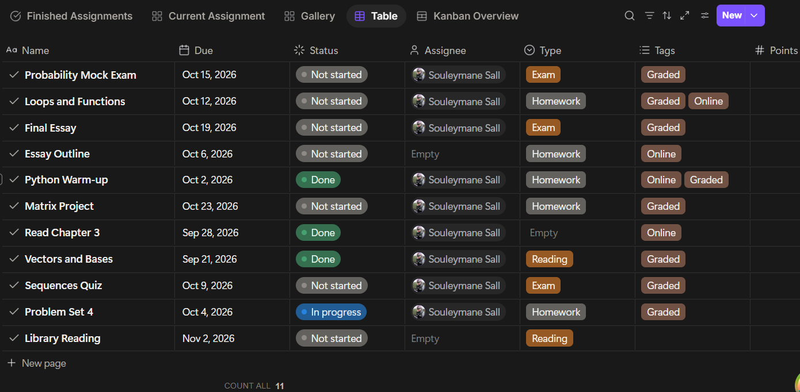
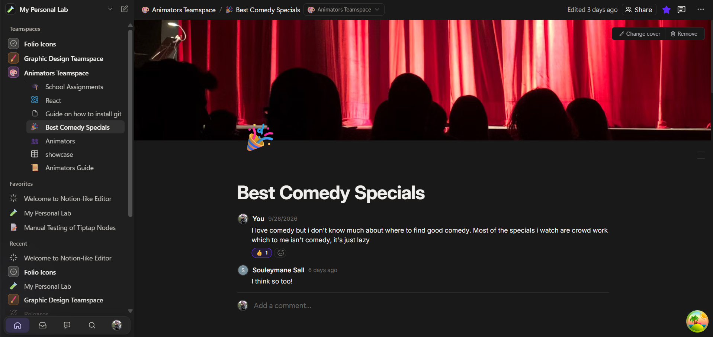

# Folio

A collaborative workspace for teams, schools and communities: a block editor, nested pages, inline databases, comments and chat, with real-time collaboration built in. Folio speaks English and French today, and more languages are coming: [help translate it](#translating-folio).

<table>
  <tr>
    <td width="50%"></td>
    <td width="50%"></td>
  </tr>
  <tr>
    <td align="center"><sub>Home: your teamspace, what's new for you, recent pages</sub></td>
    <td align="center"><sub>The editor: blocks, columns, callouts, math, code</sub></td>
  </tr>
  <tr>
    <td width="50%"></td>
    <td width="50%"></td>
  </tr>
  <tr>
    <td align="center"><sub>Databases: table, board, gallery, list, calendar, timeline</sub></td>
    <td align="center"><sub>Together: live editing, comments and chat rooms</sub></td>
  </tr>
</table>

## Why I'm building this

I wanted a tool where collaboration and notes actually stick around instead of getting lost in a chat scrollback somewhere. Rather than reinvent things Notion has already figured out (the editor, the database views, the page tree), I'm using those as a base and putting the effort into what's missing on top of that.

## Features

**Editor** (TipTap / ProseMirror)

- Text, headings, lists, to-dos, quotes, callouts with colour presets, toggles and toggle headings
- Columns you can resize (they stack on phones), tabs, tables with header toggles and saved widths, table of contents
- Code blocks with a searchable language picker, line numbers and wrap; code groups with one tab per language
- Math with KaTeX: `$…$` inline, `$$` for a block
- Images (upload, paste or drop, captions, alt text, lightbox), video (uploads, YouTube, Vimeo, Loom), audio, files with previews, web bookmarks, buttons, containers
- `/` menu with recently used blocks and search in the interface's language; `@` mentions for people, pages and dates (`@today`, `@friday`, `@in 3 days`); `:` emoji with recents
- Drag handle with a block menu: turn into, colours, move to another page, duplicate, delete
- Drag-box selection from the margin, multi-block drag, the `+` button to insert below (Alt: above)
- Paste Markdown and get blocks; export a page to Markdown, PDF or Word
- Keyboard shortcut sheet (`Ctrl+/`)

**Pages and workspaces**

- Sidebar with nested pages, recents, pinned pages, trash; quick open (`Ctrl+P`) and find in pages (`Ctrl+Shift+F`)
- Workspaces and teamspaces with members, guests and roles; access enforced in Postgres (RLS)
- Templates, page covers and icons, version history
- Works offline: pages you've opened are kept on the device and sync when you're back online

**Databases**

- Inline databases with six views: table, board, gallery, list, calendar, timeline
- Filtering, sorting and grouping; column freezing, hiding and reordering
- Drag and drop across views: board columns, gallery cards, rescheduling on the calendar, moving and resizing timeline bars

**Together**

- Real-time collaborative editing with live cursors (Yjs + Hocuspocus)
- Comments and suggestions on pages and blocks, an inbox with notifications
- Chat rooms with replies, reactions, attachments and study sessions

**Home and landing**

- Home with recently visited pages, Learn guides and templates
- A public landing page with the real editor and a live collaboration demo

## Stack

| Layer                   | Technology                                                            |
| ----------------------- | --------------------------------------------------------------------- |
| Editor                  | TipTap 3, ProseMirror                                                 |
| Frontend                | React 19, TypeScript, Vite                                            |
| Styling                 | SCSS, CSS custom properties                                           |
| Data                    | React Query (persisted for offline), Supabase JS                      |
| Backend                 | Supabase: Postgres, Auth, Row Level Security, Storage, Edge Functions |
| Real-time collaboration | Yjs, Hocuspocus                                                       |
| Languages               | i18next (English and French so far; more welcome)                     |
| Deployment              | Vercel                                                                |

## Getting started

### 1. Requirements

- Node.js 20.19 or newer (Vite 7 needs it)
- A [Supabase](https://supabase.com) project
- The [Supabase CLI](https://supabase.com/docs/guides/cli) if you want to deploy the Edge Functions

### 2. Install

```bash
npm install
```

### 3. Environment

Create `.env.local` at the repo root (it's git-ignored):

```bash
VITE_SUPABASE_URL=https://<your-project>.supabase.co
VITE_SUPABASE_PUBLISHABLE_KEY=<your publishable (anon) key>
VITE_HOCUSPOCUS_URL=ws://localhost:1234
```

### 4. Database

In a new Supabase project, open the **SQL Editor** and run, in order:

1. `supabase/migrations/000_baseline.sql`: the whole schema (tables, functions, policies, storage buckets) and a little seed data.
2. Every migration numbered `043` and higher, in order.

That's it: sign up in the app and the first account becomes the owner of the default workspace. Older migrations are kept in `supabase/migrations/archive/` for history; don't run them.

New database changes go in a new numbered file after the highest one (see [Data and security](CONTRIBUTING.md#data-and-security)).

### 5. Edge Functions

Two functions keep secrets and third-party calls off the browser:

| Function        | What it does                                            | Secret           |
| --------------- | ------------------------------------------------------- | ---------------- |
| `link-preview`  | Title, description, image and favicon for web bookmarks | none             |
| `pexels-search` | Cover image search                                      | `PEXELS_API_KEY` |

```bash
supabase secrets set PEXELS_API_KEY=<your key>
supabase functions deploy link-preview
supabase functions deploy pexels-search
```

### 6. Collaboration server

Pages are Yjs documents served by Hocuspocus. It checks each connection against Supabase (the user's token and their access to the page) and keeps documents in a local SQLite file (`folio-hocuspocus.sqlite`).

```bash
cd hocuspocus-server
npm install
```

Create `hocuspocus-server/.env`:

```bash
SUPABASE_URL=https://<your-project>.supabase.co
SUPABASE_SERVICE_ROLE_KEY=<your service role key>   # server only, never in the frontend
PORT=1234
```

Then start it:

```bash
npm start
```

### 7. Run the app

In another terminal, at the repo root:

```bash
npm run dev
```

The app opens on Vite's dev server (http://localhost:5173). The script also starts two older local servers (`server.js` on port 3001, `server/upload-server.js` on port 3000). Data and uploads have moved to Supabase and the app no longer calls them; they'll be removed.

### Other scripts

| Command                                 | What it does                |
| --------------------------------------- | --------------------------- |
| `npm run build`                         | Production build to `dist/` |
| `npm run preview`                       | Serve the production build  |
| `npm run lint`                          | ESLint                      |
| `npx tsc -p tsconfig.app.json --noEmit` | Type check                  |

## A few architecture notes

- **Every page is a Yjs document.** The editor binds to it through TipTap's Collaboration extension, and Hocuspocus syncs it. A copy is kept in IndexedDB so pages you've opened work offline; edits made offline merge back when the connection returns.
- **Database records live outside the ProseMirror document.** They're pages with a `sourceId` and a `values` map, resolved through a data source registry instead of stored inline, so the same record shows up consistently in every view.
- **A data bridge across node views.** Cell and record node views are separate React roots and can't share context. The database's top-level view publishes its computed layout into editor storage, and each node view subscribes with `useSyncExternalStore`.
- **One editor across navigation.** `EditorProvider` sits above the router, so moving between pages never remounts the editor shell. Loading states are skeletons drawn over the live editor.
- **Access control in the database.** Page visibility is enforced with Row Level Security (`can_access_page`); comment visibility follows page visibility, and the collaboration server asks the same rules before opening a document.

The folder layout and where new code goes are in [`docs/STRUCTURE.md`](docs/STRUCTURE.md).

## Where things stand

The editor is in good shape. The next steps are the databases (closing gaps in properties and views), templates, publishing pages to the web, and the community gallery.

## Translating Folio

Folio is available in English and French so far. It's meant for people everywhere, so every new language helps, and you don't need to be a developer to add one: a translation is a single JSON file.

1. Copy `src/i18n/locales/en/common.json` to `src/i18n/locales/<code>/common.json`, where `<code>` is the language's code (`wo` for Wolof, `ar` for Arabic, `pt` for Portuguese…).
2. Translate the values, never the keys. Keep `{{placeholders}}` as they are. Plurals use key endings like `_one` and `_other`; some languages need more forms (`_two`, `_few`, `_many`), see [i18next plurals](https://www.i18next.com/translation-function/plurals).
3. Register the language in `src/i18n/config.ts`: import the file, add it to `resources`, and add it to `SUPPORTED_LANGUAGES` with its name in that language.
4. Add its code to `LOCALES` in `scripts/check-i18n.mjs`, then run `node scripts/check-i18n.mjs` to find keys you missed.
5. Open a pull request. A partial translation is welcome too: missing strings fall back to English, and someone else can finish it.

Improving an existing translation (a clumsy sentence, a wrong term) is just as useful: edit the file and open a pull request.

## Contributing

Folio is mostly built by [Jule](https://github.com/Jule-25). Issues and pull requests are welcome: see [CONTRIBUTING.md](CONTRIBUTING.md) for how to set up, the conventions, and how to open a pull request.

## Licence

Folio is free software, licensed under the [GNU Affero General Public License v3.0](LICENSE) (`AGPL-3.0-only`).

In short: you can use, study, change and share Folio, including running it for other people. If you run a modified version that people use over a network, you have to make your modified source code available to them, under the same licence.

If you'd like to use Folio under different terms (for example, to build it into a closed-source product), contact the maintainer through [GitHub](https://github.com/Jule-25).

Copyright © 2026 Jule and the Folio contributors.
